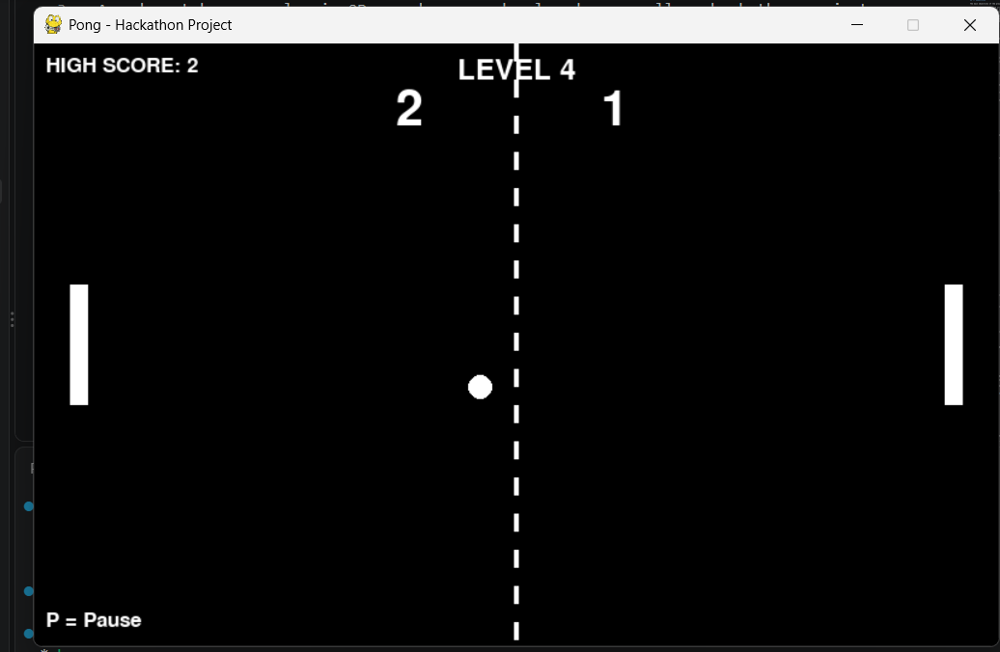

# 🕹️ Classic Arcade Game Clone

A modern take on a classic 2D arcade game, developed as a college hackathon project.

The project focuses on recreating the core gameplay of a classic arcade game while adding modern gameplay elements such as progressive difficulty, score tracking, polished UI, and a complete game/restart flow.

---

## 🎮 Project Overview

Classic arcade games are built around simple mechanics that are easy to understand but challenging to master.

This project explores how those mechanics can be recreated from scratch using a 2D game framework, while implementing the fundamental concepts behind game development:

* Game loops
* User input
* 2D movement
* Collision detection
* Score tracking
* Difficulty progression
* Game states
* Restart and replay systems
* Basic game UI
* Sound and visual feedback

The final game will be based on a classic arcade concept such as **Snake, Flappy Bird, or Pong**, with additional features to make the experience more engaging than a basic clone.
## Game Screenshot



---

## 🎯 Objectives

The main objectives of the project are:

* Build a fully playable 2D arcade game.
* Recreate the core mechanics of a classic arcade game.
* Implement a responsive control system.
* Track and display the player's score.
* Introduce progressive difficulty as the player continues playing.
* Implement collision detection and game-over conditions.
* Provide a restart/replay mechanism.
* Create a clean and visually appealing game interface.
* Explore fundamental concepts involved in 2D game development.

---

## ✨ Planned Features

### Core Gameplay

* 🎮 Player-controlled gameplay
* 🧩 Classic arcade mechanics
* 💥 Collision detection
* 📊 Real-time score tracking
* ⚡ Increasing difficulty
* 💀 Game-over state
* 🔄 Restart functionality

### Game Progression

The game will progressively become more challenging as the player's score increases.

Possible difficulty changes include:

* Increased movement speed
* Faster obstacles
* Increased obstacle frequency
* Reduced reaction time
* More challenging game environments

---

## 🚀 Additional Features

To make the project more than a basic arcade clone, additional features may include:

### 🏆 High Score System

Track the player's highest score across multiple games.

### ⭐ Power-Ups

Introduce temporary abilities or bonuses that change gameplay.

Examples:

* Speed boost
* Shield
* Bonus points
* Slow motion
* Temporary invincibility

### 🎚️ Difficulty Levels

Possible difficulty modes:

* Easy
* Normal
* Hard

Each mode can modify gameplay parameters such as speed, obstacle frequency, or reaction time.

### ⏸️ Pause & Resume

Players can pause the game and continue without losing their current progress.

### 🔊 Sound Effects

Gameplay feedback may include:

* Movement/gameplay sounds
* Score or item collection sounds
* Level-up sounds
* Collision sounds
* Game-over sounds

### 🎨 Visual Effects

The game may include:

* Animated UI
* Particle effects
* Screen transitions
* Dynamic backgrounds
* Theme-based visuals

### 🏅 Achievements

Optional achievements can reward players for reaching specific milestones.

Examples:

* First Score
* High Scorer
* Speed Demon
* Survivalist
* Master Player

---

## 🖥️ Game Flow

The expected game flow is:

```text
              ┌──────────────┐
              │  Main Menu   │
              └──────┬───────┘
                     │
                     ▼
              ┌──────────────┐
              │    Start     │
              │     Game     │
              └──────┬───────┘
                     │
                     ▼
              ┌──────────────┐
              │   Gameplay   │
              │              │
              │ Score ↑      │
              │ Difficulty ↑ │
              └──────┬───────┘
                     │
              Collision / Loss
                     │
                     ▼
              ┌──────────────┐
              │  Game Over   │
              │              │
              │ Score: XX    │
              │ High Score   │
              └──────┬───────┘
                     │
              ┌──────┴───────┐
              ▼              ▼
           Restart        Main Menu
```

---

## 🛠️ Technology Stack

The project will use a lightweight 2D game development stack.

### Planned Technology

* **Language:** Python
* **Game Framework:** Pygame
* **Version Control:** Git & GitHub

Depending on the final project direction, the technology stack may alternatively use:

* HTML5
* CSS
* JavaScript
* HTML5 Canvas

---

## 🏗️ Core Game Architecture

The project will be organized into separate components rather than placing the entire game inside a single file.

Possible architecture:

```text
                    Game
                     │
        ┌────────────┼────────────┐
        │            │            │
        ▼            ▼            ▼
     Player       Objects        UI
        │            │            │
        │            │            ├── Score
        │            │            ├── Menu
        │            │            └── Game Over
        │            │
        ▼            ▼
    Movement     Collision
                     │
                     ▼
               Game State
                     │
          ┌──────────┼──────────┐
          ▼          ▼          ▼
        Playing    Paused    Game Over
```

The exact architecture will depend on the game selected.

---

## 📁 Planned Project Structure

```text
classic-arcade-game/
│
├── main.py
├── game.py
├── player.py
├── objects.py
├── ui.py
├── settings.py
│
├── assets/
│   ├── images/
│   ├── sounds/
│   └── fonts/
│
├── README.md
├── requirements.txt
└── .gitignore
```

The structure may be modified during development as the project grows.

---

## 🎮 Controls

The exact controls will depend on the selected game.

Possible controls:

| Key   | Action           |
| ----- | ---------------- |
| ↑ / W | Move Up          |
| ↓ / S | Move Down        |
| ← / A | Move Left        |
| → / D | Move Right       |
| P     | Pause            |
| R     | Restart          |
| ESC   | Main Menu / Exit |

---

## 📈 Difficulty Progression

Difficulty will dynamically increase as the player progresses.

Example:

```text
Level 1
   ↓
Normal speed
   ↓
Score increases
   ↓
Level 2
   ↓
Increased speed
   ↓
Score increases
   ↓
Level 3
   ↓
Higher speed / additional challenges
```

The exact progression system will be tuned during development and testing.

---

## 🧠 Concepts Demonstrated

This project demonstrates practical programming and game-development concepts including:

* Object-oriented programming
* Event handling
* Game loops
* Keyboard input
* 2D coordinate systems
* Collision detection
* Randomization
* State management
* Timers
* Score systems
* Difficulty scaling
* File-based data persistence
* Modular code organization

---

## 🧪 Testing

The game will be tested for:

* Correct player controls
* Collision accuracy
* Score calculation
* Difficulty progression
* Game-over conditions
* Restart functionality
* Pause/resume functionality
* High-score persistence
* Performance during extended gameplay

---

## 🔮 Future Scope

Potential future improvements include:

* Online leaderboards
* Multiplayer mode
* Player profiles
* Additional game modes
* Custom skins/themes
* More power-ups
* Advanced AI opponents
* Cloud-based score storage
* Mobile/Web deployment
* Additional classic arcade games within the same application

---

## 👥 Team

**Hackathon Project Team**

Team members and individual responsibilities will be added here.

| Member   | Role | Responsibilities |
| -------- | ---- | ---------------- |
| Member 1 | —    | —                |
| Member 2 | —    | —                |
| Member 3 | —    | —                |
| Member 4 | —    | —                |

---

## 🏁 Project Status

🚧 **Currently in Planning & Development**

The project is being developed incrementally, beginning with the core gameplay mechanics and gradually adding progression, UI, audio, and additional gameplay features.

---

## 📜 License

This project was created for educational and hackathon purposes.
