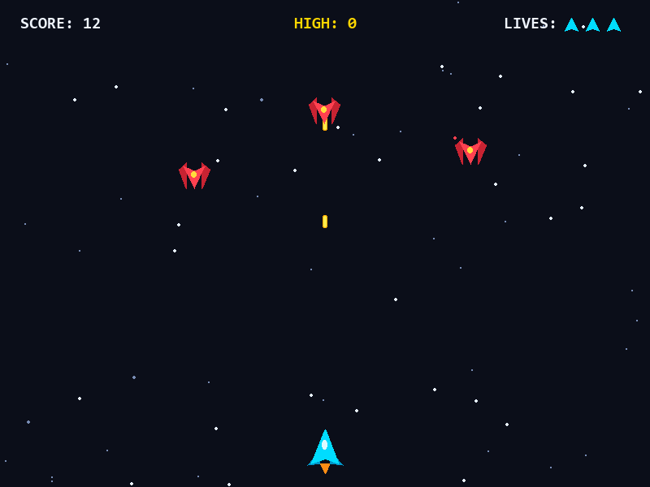

# 🚀 Space Shooter (Arcade 2.0)

A classic 2D retro arcade Space Shooter built with Python and Pygame for the Arcade 2.0 Hackathon.



---

## 📖 Game Description

Defend your sector from descending waves of alien invaders! Control your starship at the bottom of the screen, dodge or destroy incoming enemies, and rack up the highest score possible before your 3 lives run out. As your score increases, enemy ships move faster and spawn more frequently, demanding quick reflexes and precise targeting.

---

## 🎮 Controls

| Key | Action |
| :--- | :--- |
| **A** or **Left Arrow** | Move ship Left |
| **D** or **Right Arrow** | Move ship Right |
| **SPACE** | Shoot laser bullets / Start game from Title Screen |
| **P** | Pause / Resume gameplay |
| **R** | Restart game (after Game Over) |
| **ESC** | Exit game |

---

## ✨ Features

- **Responsive Spaceship Controls:** Smooth horizontal maneuvering with boundary clamping.
- **Dynamic Difficulty Progression:** Enemy descent speed and spawn rates increase naturally as your score rises.
- **Game States:** Complete lifecycle support for **Start Screen**, **Active Play**, **Pause Overlay**, and **Game Over Summary**.
- **Local High Score Tracking:** Automatically persists your personal best score to `highscore.txt`.
- **Arcade Visuals:**
  - Procedurally animated multi-layered scrolling starfield.
  - Custom vector-drawn player spaceship with animated engine thruster flame.
  - Alien invader ship models with colored cores.
  - Particle explosion bursts when destroying enemies or taking damage.
  - Clean HUD displaying current score, best record, and remaining lives.
- **Zero External Asset Dependencies:** Runs completely out-of-the-box using Pygame drawing primitives—no missing image file errors.
- **Audio-Safe:** Graceful audio mixer initialization that runs smoothly whether or not a physical sound card is present.

---

## 🕹️ How to Run the Game

### 1. Requirements

Ensure Python 3.10+ and `pygame` (or `pygame-ce`) are installed:

```bash
pip install pygame-ce
# or: pip install pygame
```

### 2. Launching the Game

From the root project directory:

```bash
python space_shooter/main.py
```

Or navigate into the `space_shooter` folder and run directly:

```bash
cd space_shooter
python main.py
```
